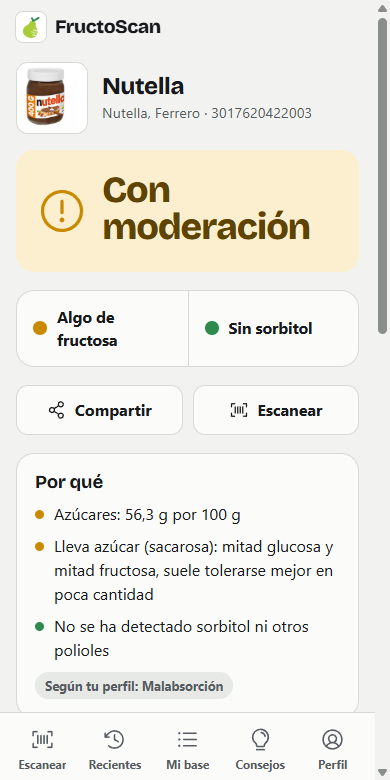
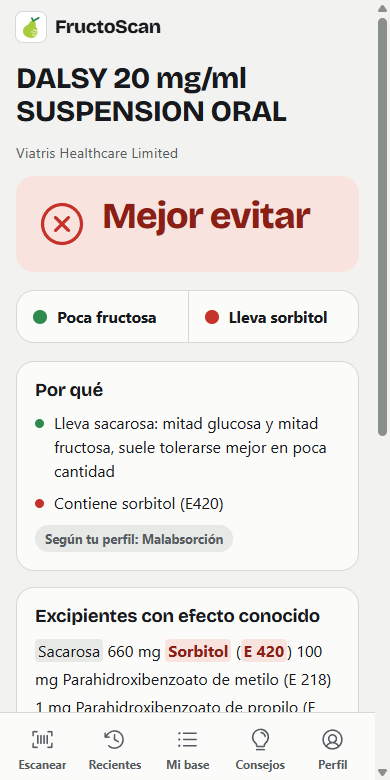
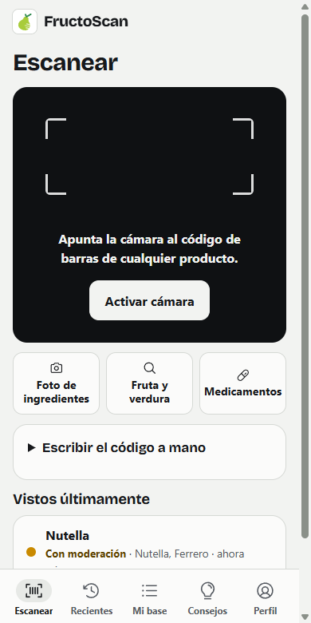
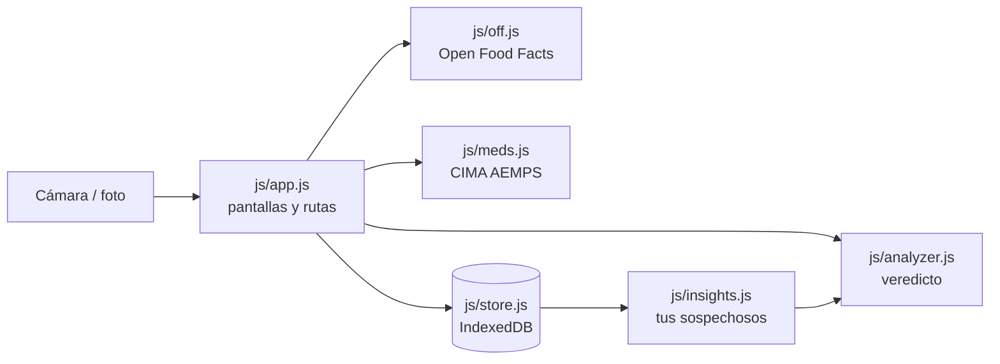

# FructoScan

> Escanea un producto del súper y te dice al momento si te conviene, y por qué. Para personas con malabsorción de fructosa, intolerancia hereditaria a la fructosa (IHF) o dieta baja en FODMAP.

[](https://github.com/alejandrorevillaEng/fructoscan/actions/workflows/ci.yml)
[](LICENSE)

**Pruébala:** https://fructosa.pages.dev

<p>
  
  
  
</p>

## Por qué existe

Nace de un problema real: hacer la compra leyendo etiquetas una a una. La fructosa aparece con muchos nombres (jarabe de glucosa-fructosa, sirope de agave, zumo concentrado…) y el sorbitol se esconde como E420 en lo que pone «sin azúcar». FructoScan hace esa lectura en el pasillo del súper y explica de dónde sale cada resultado.

## Qué hace

- **Escanea el código de barras** con la cámara (o se escribe a mano) y busca el producto en [Open Food Facts](https://es.openfoodfacts.org).
- **Veredicto por producto** (Apto, Con moderación o Mejor evitar) con dos indicadores, fructosa y sorbitol, y el porqué ingrediente a ingrediente, resaltado en la lista.
- **Tres perfiles:** malabsorción, IHF (estricto: cualquier fructosa, sacarosa o sorbitol es un no) y FODMAP (añade fructanos: trigo, cebolla, ajo…).
- **Si el producto no está**, lee la lista de ingredientes de una foto (OCR dentro del móvil) o se escribe a mano, y se guarda para la próxima vez.
- **Modo súper:** con la cámara abierta, el veredicto aparece encima y se sigue escaneando; lo escaneado se reúne en «En esta compra».
- **Medicamentos:** busca por nombre cualquier medicamento autorizado en España y analiza sus excipientes con la ficha técnica oficial del [CIMA de la AEMPS](https://cima.aemps.es). Muchos jarabes llevan sacarosa o sorbitol.
- **Tus sospechosos:** con lo que marcas en «¿Qué tal te sentó?», cruza lo que te sentó mal con sus ingredientes y enseña qué se repite.
- **Fruta y verdura:** fructosa y glucosa por 100 g de los alimentos frescos más comunes.
- **Sin registro:** todo se guarda en el móvil, con copia de seguridad en un archivo. Funciona sin conexión y se instala en la pantalla de inicio.

## Stack y decisiones técnicas

| Pieza | Tecnología | Por qué |
|---|---|---|
| Interfaz | HTML, CSS y JavaScript con módulos ES, sin framework ni compilación | Carga al instante en un móvil normal y el código se lee tal cual se ejecuta |
| Motor de análisis | Módulo puro (`js/analyzer.js` + reglas en `js/rules.js`) | Sin DOM ni red: se prueba entero con tests y las reglas se revisan sin tocar la interfaz |
| Datos del usuario | IndexedDB en el navegador | Son datos de salud: si no salen del móvil, no hay servidor que proteger ni datos de nadie guardados |
| Productos | Open Food Facts | Base de datos abierta y con mucha cobertura en España |
| Medicamentos | API pública del CIMA (AEMPS) | Es el registro oficial y trae los excipientes con su cantidad |
| Lectura de códigos | `BarcodeDetector` del navegador, con ZXing de respaldo | El nativo es más rápido; ZXing cubre los navegadores que no lo tienen (Safari, Firefox) |
| OCR | Tesseract.js con el idioma español | Lee la foto dentro del móvil: la imagen no se sube a ningún sitio |
| Iconos | Phosphor Icons | Una sola familia, generados desde sus SVG oficiales |
| Despliegue | Cloudflare Pages + GitHub Actions | Estático, gratis y con cabeceras de seguridad configurables (`_headers`) |

## Arquitectura



`js/app.js` es un router por hash (`#/p/<código>`, `#/med/<registro>`…) que pinta cada pantalla con un pequeño helper que construye el DOM sin `innerHTML`. Los datos externos (Open Food Facts, CIMA, copias de seguridad) se validan al entrar, y la lógica que decide el veredicto vive en el motor, que no sabe nada de la interfaz.

## Cómo ejecutarlo

Requisitos: Node 22 o superior (para los tests) y Python 3 (para servirla en local). No hay dependencias que instalar.

```bash
git clone https://github.com/alejandrorevillaEng/fructoscan.git
cd fructoscan
npm start
```

Abre http://localhost:5180. La cámara funciona en `localhost` sin HTTPS. `npm start` llama a `python`; si en tu sistema es `python3` o `py`, usa `python3 -m http.server 5180`.

## Tests

```bash
npm test
```

Usan el runner de Node, sin dependencias. Cubren:
- **Motor de análisis:** detección de ingredientes, veredictos por perfil, resaltado, limpieza del texto del OCR, alimentos frescos y códigos de barras.
- **Medicamentos:** con respuestas reales del CIMA grabadas, para no depender de la red.
- **Tus sospechosos** y **copia de seguridad** (validación de lo que se importa y unión con lo que ya hay).
- **Configuración publicada:** que la CSP no se afloje, HSTS y que el modo sin conexión guarda todos los archivos.

## Seguridad y privacidad

- **Sin cuentas ni servidor propio.** Perfil, productos, notas y valoraciones se quedan en el navegador del móvil. Lo único que sale es el código de barras (a Open Food Facts) o el nombre del medicamento (al CIMA).
- **Nada de HTML con datos externos:** todo se pinta como texto, y los enlaces e imágenes externos solo se aceptan de los dominios esperados.
- **Copias de seguridad validadas** campo a campo antes de importarlas.
- **Cabeceras estrictas** en `_headers`: CSP sin scripts en línea y con `connect-src` limitado a las dos APIs, HSTS, `frame-ancestors 'none'` y cámara solo para la propia web.
- **CI:** cada cambio pasa los tests antes de publicarse. Las Actions están fijadas por SHA y Dependabot las mantiene al día.
- Para informar de una vulnerabilidad: [SECURITY.md](SECURITY.md).

No es un producto sanitario ni sustituye el consejo de un médico o dietista. Los resultados son una estimación a partir de los ingredientes.

## Autor

Alejandro Revilla Blanco

## Licencia

[MIT](LICENSE). Datos de productos de Open Food Facts bajo licencia ODbL.
